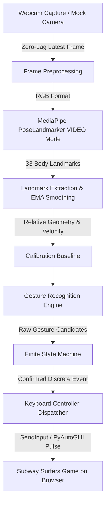

# 🏃‍♂️ Subway Surfers AI Body Controller (Vision Lab)

Ứng dụng desktop tương tác thời gian thực cho phép điều khiển tựa game nổi tiếng **Subway Surfers** trên trình duyệt thông qua **chuyển động cơ thể** (Body Gestures) bằng Webcam và **MediaPipe Tasks Vision Pose Landmarker**.

Dự án được thiết kế chuyên biệt cho hoạt động trải nghiệm AI & Computer Vision của học sinh THPT, đề cao tính **trực quan, độ nhạy cao, độ trễ thấp (<150ms) và giao diện phong cách AI Vision Lab hiện đại**.

---

## 🌟 Tính Năng Nổi Bật

- **4 Động tác cốt lõi:**
  - ⬅️ **Vùng trái:** Đưa nhân vật đến làn trái (`Left Arrow`).
  - ➡️ **Vùng phải:** Đưa nhân vật đến làn phải (`Right Arrow`).
  - **Vùng giữa:** Đưa nhân vật về làn giữa, phát phím tùy làn đang điều khiển.
  - ⬆️ **Bật nhảy tại chỗ (Jump):** Nhân vật nhảy lên né chướng ngại vật (`Up Arrow`).
  - ⬇️ **Cúi hoặc hạ thấp người (Crouch / Roll):** Nhân vật cuộn tròn trượt dưới thanh chắn (`Down Arrow`).
- **Chế độ Lean Mode:** Dành cho không gian phòng học hẹp, cho phép nghiêng người sang trái/phải thay vì bước chân.
- **Hệ thống Hiệu chỉnh (Calibration System):**
  - Đếm ngược trực quan 3 giây với hướng dẫn tiếng Việt.
  - Thu thập tư thế trung lập (Neutral Baseline) và tính toán ngưỡng thích ứng theo tỷ lệ cơ thể (chiều dài thân, độ rộng vai), không phụ thuộc kích thước cố định hay khoảng cách camera.
- **Hệ thống Nhận diện Khử Nhiễu & Chống Spam Phím:**
  - Máy trạng thái hữu hạn (**Finite State Machine**) với Hysteresis, Temporal Confirmation (Debouncing), và Cooldown độc lập cho từng hành động.
  - Làn đích tương ứng với vùng chứa tâm thân người. Chuyển thẳng trái ↔ phải phát hai phím cùng hướng, cách nhau tối thiểu 120 ms theo cấu hình mặc định.
  - Giữ nguyên vùng không lặp phím sau khi đã đến làn đích. Nhảy/cúi cần đưa tâm thân trở lại giữa hai vạch ngang trước khi lặp cùng động tác.
  - Ưu tiên động tác Nhảy/Cúi trước chuyển động ngang khi có chuyển động kết hợp.
- **Khóa người chơi chính (Player Lock):**
  - Mặc định theo dõi một người để giảm tải và tận dụng tracking của MediaPipe. Nếu cần chọn người chơi giữa nhiều người trong khung hình, đặt `mediapipe.max_num_poses` thành `2`; chế độ này tốn thêm thời gian suy luận.
- **Bộ điều khiển Phím Đa Tầng:**
  - Hỗ trợ cả **Windows Direct SendInput / `keybd_event`** và **PyAutoGUI** đảm bảo Canvas / WebGL game trên trình duyệt nhận lệnh 100% không bị nuốt phím.
  - Phát phím bất đồng bộ (Non-blocking Asynchronous Pulse ~65ms), không bao giờ làm giật lag luồng camera hay AI.
  - Kiểm tra trạng thái **Game Focused / Not Focused** để không gửi phím ra ngoài ý muốn.
  - Chế độ **Test Only** (thử nghiệm cử chỉ không gửi phím) và nút **Emergency Stop** an toàn.
- **Giao diện PySide6 AI Vision Lab:**
  - Bảng màu Dark Navy & Neon Cyan/Electric Blue hiện đại.
  - Skeleton Overlay vẽ xương và khớp thời gian thực.
  - Đường kẻ ranh giới các vùng LEFT / CENTER / RIGHT và vạch mốc Jump / Crouch.
  - 4 thẻ Gesture Indicator phát sáng nhấp nháy sinh động.
  - Dashboard Metrics hiển thị: FPS Camera, FPS AI Inference, Latency (ms), Confidence %, số hành động Accepted / Debounced.
- **Chế độ Mock Camera:** Cho phép chạy và thử nghiệm đầy đủ ứng dụng trên máy không có Webcam vật lý.

---

## 🏗️ Kiến Trúc Hệ Thống



---

## 💻 Yêu Cầu Hệ Thống & Công Nghệ

**Thiết bị chạy AI:** Cả model Lite và Full hiện chạy trên **CPU**, được cấu hình
tường minh bằng `BaseOptions.Delegate.CPU`. MediaPipe Tasks Python đang dùng chưa
hỗ trợ GPU trên Windows; cài CUDA không tự chuyển model sang GPU.
Xem [tài liệu BaseOptions của Google](https://ai.google.dev/edge/api/mediapipe/python/mp/tasks/BaseOptions).

**Khởi động camera:** Mở/configure webcam và nạp model chạy trên các luồng nền song song.
Giao diện hiển thị hình camera ngay khi có frame, kể cả khi AI còn đang nạp.
Model được giữ lại khi tắt camera để bật lại nhanh hơn; đổi Lite/Full cũng chạy trên
luồng xử lý AI để tránh đóng model trong lúc suy luận. Bảng cấu hình hiển thị
`AI: CPU`, thời gian nhận frame đầu tiên và tổng thời gian đến kết quả AI đầu tiên.
Log terminal ghi riêng `[Camera]`, `[AI]`, `[Startup]` để phân biệt chậm do driver hay model.
Thời gian mở webcam thực tế vẫn phụ thuộc thiết bị và driver. Nếu mở webcam thất bại,
ứng dụng báo lỗi; muốn chạy giả lập, chọn `Mock Camera` hoặc dùng `--mock-camera`.

**Chế độ phản hồi nhanh:** Cấu hình mặc định yêu cầu camera **640×480, 60 FPS**
với model Lite và một người chơi. Camera giữ khung hình mới nhất; AI bỏ qua các
khung hình cũ nếu không xử lý kịp. Phần xem camera cập nhật riêng theo nhịp khoảng
60 Hz, không phải chờ kết quả AI và không tích hàng đợi video trong giao diện.
Khung xương dùng kết quả AI mới nhất, nên độ mượt hình camera và tốc độ nhận cử chỉ
có thể khác nhau.

Badge `CAM … FPS` đo tốc độ nhận khung hình tại luồng camera; bảng `Cam / AI FPS`
hiển thị riêng tốc độ camera và số lần xử lý AI mỗi giây. Dòng cấu hình ghi FPS
yêu cầu, FPS driver báo và FPS đo được. Driver báo 60 FPS không đảm bảo cảm biến
thực sự trả 60 khung hình mỗi giây. Webcam chỉ hỗ trợ 30 FPS sẽ không trở thành
camera 60 FPS nhờ thay đổi cấu hình; muốn 60 FPS thực cần webcam hỗ trợ chế độ đó.

- **Hệ điều hành:** Windows 10 / 11 (64-bit).
- **Python:** Phiên bản 3.11 hoặc 3.12.
- **Thư viện chính:**
  - `mediapipe >= 0.10.14` (Sử dụng API mới `mp.tasks.python.vision.PoseLandmarker`, model `.task`)
  - `opencv-python >= 4.8.0`
  - `PySide6 >= 6.6.0`
  - `numpy >= 1.24.0, < 2.0.0`
  - `pyautogui >= 0.9.54`
  - `pywin32 >= 306`
  - `pytest >= 7.4.0`

---

## 🚀 Hướng Dẫn Cài Đặt Nhanh

### Cách 1: Tự động hoàn toàn (Khuyên dùng trên Windows)

1. Mở thư mục dự án trong Windows Explorer hoặc PowerShell.
2. Nhấp đúp vào file **`setup_env.bat`** (hoặc chạy trong PowerShell: `.\setup_env.ps1`).
3. Script sẽ tự động:
   - Tạo môi trường ảo `venv`.
   - Cài đặt đầy đủ các thư viện trong `requirements.txt`.
   - Tải về hai mô hình chính thức của Google: `pose_landmarker_lite.task` và `pose_landmarker_full.task`.

Hai file setup luôn dùng `venv\Scripts\python.exe` nằm cạnh script, kể cả khi chạy
từ thư mục khác. Thư viện chỉ được cài vào `venv\Lib\site-packages`; cache pip
nằm trong `venv\.cache\pip` và file tạm nằm trong `venv\.tmp` trên ổ đĩa chứa
dự án. Setup bỏ qua cấu hình pip có thể chuyển nơi cài đặt, chặn cài vào user/system
Python và dừng ngay nếu môi trường ảo không hợp lệ hoặc cài đặt thất bại.
Không cần kích hoạt venv hay chạy bằng quyền Administrator.

---

### Cách 2: Cài đặt thủ công bằng dòng lệnh

```powershell
# 1. Tạo môi trường ảo
python -m venv venv

# 2. Kích hoạt môi trường ảo
.\venv\Scripts\activate

# 3. Nâng cấp pip và cài đặt thư viện
pip install --upgrade pip
pip install -r requirements.txt

# 4. Tải model MediaPipe Tasks chính thức
python download_models.py
```

---

## 🎮 Hướng Dẫn Sử Dụng & Trải Nghiệm Game

1. **Khởi động ứng dụng:**
   - Nhấp đúp **`run.bat`** (hoặc chạy: `.\venv\Scripts\python main.py`).
2. **Bật Camera:**
   - Trong bảng điều khiển bên phải, chọn Webcam (thường là `Webcam 0`) và nhấn **`▶ Bật Camera (Start Camera)`**.
   - Bạn sẽ nhìn thấy hình ảnh của bản thân với khung xương AI màu xanh neon.
3. **Hiệu chỉnh (Calibration):**
   - Đứng lùi lại sao cho camera nhìn rõ từ đầu đến ngang đùi / đầu gối.
   - Nhấn **`🎯 Hiệu chỉnh Baseline (Calibrate)`**.
   - Giữ nguyên tư thế đứng thẳng trong 3 giây đếm ngược.
   - Màn hình thông báo **"CALIBRATION COMPLETE!"**.
4. **Mở Game Subway Surfers:**
   - Nhấn **`🌐 Mở Game Subway Surfers (Poki)`**. Trình duyệt sẽ mở trang game chính thức tại `https://poki.com/en/g/subway-surfers`.
   - Click chuột vào vùng game và nhấn phím cách (Space) hoặc thử các phím mũi tên để bắt đầu chạy.
   - Sắp xếp cửa sổ game và cửa sổ ứng dụng Controller cạnh nhau.
5. **Kích hoạt điều khiển AI:**
   - Nhấn **`🎮 Bắt đầu Điều khiển (Start Control)`**.
   - Giữ cửa sổ trình duyệt Subway Surfers được active/focus.
   - Sử dụng cơ thể để chơi:
     - Bước sang trái/phải để đổi làn.
     - Nhảy lên để né tàu xe.
     - Cúi người để trượt qua rào chắn!

Ở chế độ **3 vùng (Làn)**, Calibrate tự đo vị trí hai vai từ **30 mẫu**, dùng trung vị
để giảm ảnh hưởng của nhiễu. Vùng CENTER lấy chấm đỏ lúc đứng thẳng làm tâm và có
độ rộng thông thường bằng **80% khoảng cách ngang giữa hai vai**. Người có vai nhỏ
hoặc đứng xa camera sẽ có hai vạch gần nhau hơn. Có giới hạn để vùng giữa không quá
hẹp hoặc quá rộng, và các vạch luôn nằm trong ảnh. Chấm đỏ giữa vai và hông là điểm
điều khiển; các vạch giữ nguyên trong lúc chơi, không đuổi theo người.

Trong `config.json`, `control.auto_calibrate_lanes` mặc định là `true`;
`control.lane_shoulder_width_factor` mặc định `0.8`, có thể giảm để hai vạch gần nhau
hơn theo tỷ lệ vai. Khi tắt tự căn, `control.lane_center_half_width` quy định khoảng
cách mỗi vạch tới tâm ảnh (mặc định `0.10`). Trước lần Calibrate đầu tiên, vạch dọc
ở 40% / 60% chỉ là mốc xem trước.
Chấm ở vùng nào thì nhân vật được đưa đến làn đó; trở về vùng giữa cũng đưa nhân vật
về làn giữa. Có thể chuyển thẳng từ vùng trái sang phải và ngược lại, không cần
dừng ở giữa. Các phím còn lại của đích cũ bị hủy khi bạn đổi vùng.

Hai vạch ngang xanh lá và vàng/cam được tính theo độ cao tâm thân lúc Calibrate.
Chấm đỏ vượt lên vạch xanh kích hoạt nhảy; xuống dưới vạch vàng/cam kích hoạt cúi.
Thanh độ nhạy thay đổi khoảng cách hai vạch ngang; ranh giới ba vùng dọc giữ nguyên.
Đường vẽ và bộ nhận diện dùng cùng một bộ tọa độ. Hãy đứng thẳng gần giữa ảnh khi
hiệu chỉnh, để thấy rõ cả hai vai và hai hông; không cần căn vào vạch cũ. Calibrate
sẽ chờ nếu một vai bị che hoặc ra ngoài ảnh. Đổi người chơi, vị trí đứng hoặc khoảng
cách camera thì Calibrate lại. Trước khi hiệu chỉnh, các vạch ngang chỉ là vị trí xem trước.

Ứng dụng ước tính làn nhân vật từ các phím đã phát, không đọc trạng thái game trên
trình duyệt. Khi bắt đầu lại sau game over, đưa nhân vật về làn giữa rồi nhấn
**Đồng bộ làn giữa (Lượt mới)**. Nhấn nút này chỉ đồng bộ bộ điều khiển, không gửi
phím để kéo nhân vật về giữa. Giữ cửa sổ game có focus để nhận phím; Test Only chỉ
mô phỏng điều khiển. Tắt Test Only sẽ dừng điều khiển; hãy đồng bộ làn trước khi
bật điều khiển thật.

---

## ⚙️ Các Tham Số Dòng Lệnh Nâng Cao

Ứng dụng hỗ trợ các cờ dòng lệnh tiện lợi:

```powershell
# Chạy với camera giả lập (Mock Mode) khi máy không có webcam
python main.py --mock-camera

# Chạy ở chế độ Test Mode (không bấm phím thật)
python main.py --test-mode

# Sử dụng model độ chính xác cao Pose Landmarker Full
python main.py --model full

# Tùy chỉnh file cấu hình khác
python main.py --config my_custom_config.json
```

---

## 🧪 Chạy Kiểm Thử Tự Động (Unit Tests)

Dự án tích hợp bộ kiểm thử khung xương, điều khiển và vòng đời camera/model không phụ thuộc webcam vật lý:

```powershell
.\venv\Scripts\pytest -v
```

Các ca kiểm thử bao gồm:
- Đứng yên trong vùng trung lập -> Không phát lệnh.
- Giữa → trái/phải -> Một lệnh đổi làn; trái ↔ phải trực tiếp -> Hai lệnh cùng hướng.
- Giữ nguyên tư thế -> Không spam lặp phím liên tục.
- Trở về vùng giữa -> Phát lệnh đưa nhân vật về làn giữa.
- Bật nhảy và tiếp đất -> Đúng 1 lệnh Jump.
- Cúi người và đứng dậy -> Đúng 1 lệnh Crouch.
- Khử nhiễu landmark / độ tin cậy thấp -> Không phát phím sai.
- Mất người chơi (Tracking lost) -> Dừng gửi phím ngay lập tức.
- Nghiêng người kết hợp cúi -> Ưu tiên Crouch, không phát lệnh nhầm.
- Lật gương camera (Mirrored) -> Vùng trên ảnh luôn khớp hướng điều khiển, không đảo tọa độ hai lần.
- Phím bị từ chối / bộ phát phím đang bận -> Không cập nhật nhầm làn, không tích hàng đợi phím.
- Cửa sổ game không có focus -> Chặn phím không gửi vào ứng dụng khác.

---

## 📦 Đóng Gói Thành File Thực Thi Windows (.exe)

Nếu muốn đóng gói thành file chạy độc lập phân phối cho học sinh mà không cần cài Python:

```powershell
.\venv\Scripts\python build_exe.py
```

File thực thi và toàn bộ tài nguyên sẽ được tạo tự động trong thư mục `dist/SubwaySurfersAIController/`.

---

## 🛠️ Khắc Phục Sự Cố Thường Gặp (Troubleshooting)

1. **Camera không mở được:**
   - Kiểm tra xem Windows Settings > Privacy & Security > Camera đã cấp quyền cho ứng dụng máy tính hay chưa.
   - Thử đổi cổng USB hoặc chọn `Webcam 1` trong dropdown.
   - Có thể chọn `Mock Camera (Test AI)` để kiểm tra giao diện và tính năng.
2. **Game không nhận phím:**
   - Đảm bảo đã nhấp chuột vào khung game trong trình duyệt (Chrome/Edge/Brave) để game có tiêu điểm (Focus).
   - Đèn chỉ báo trên ứng dụng phải hiển thị `🟢 FOCUSED`.
   - Nếu dùng trình duyệt đặc thù, bạn có thể bỏ tích chọn ô `Chỉ gửi phím khi Game có Focus` trong bảng điều khiển.
3. **Cử chỉ nhạy quá hoặc chậm:**
   - Điều chỉnh thanh trượt **Độ nhạy cử chỉ (Sensitivity)** từ `0.5x` đến `2.5x` cho phù hợp với thể trạng và không gian phòng.
   - Nhấn **Calibrate** lại bất kỳ lúc nào nếu người chơi thay đổi khoảng cách đứng so với camera.

---

**Made with ❤️ for STEM & AI Education.**
